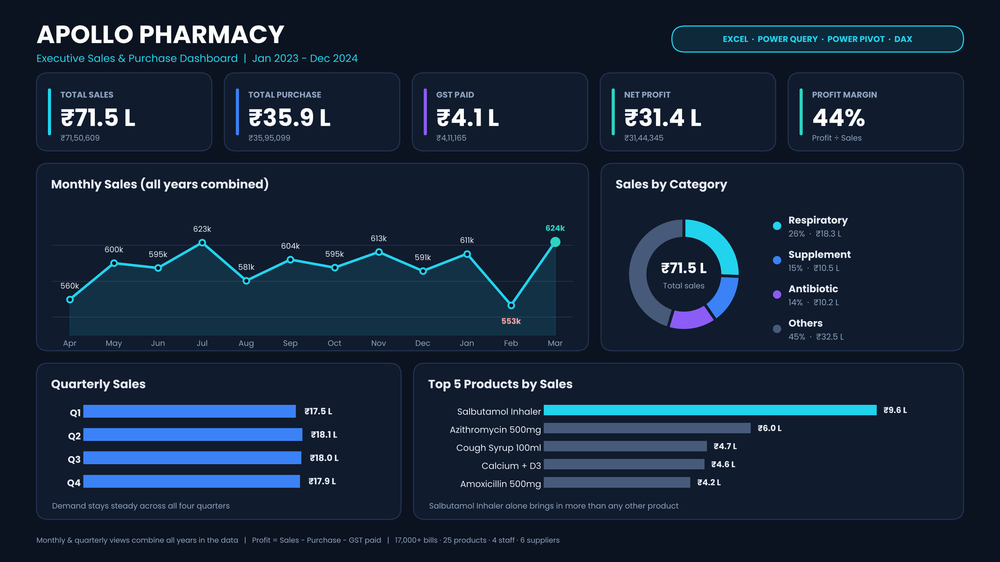

# 💊 Apollo Pharmacy Executive Dashboard (Excel)

An end-to-end sales and purchase analytics dashboard built **only in Excel** using Power Query, Power Pivot and DAX.



> The image above is a redesigned preview of the dashboard. The working, interactive dashboard (with slicers) is in `PHARMACY_DASHBOARD_V1.xlsx`, on the `dashboard` sheet.

## 📌 Project Overview
Weekly sales and purchase files were combined, cleaned and modelled to answer simple business questions:
- How much did the pharmacy sell, buy and earn?
- Which categories and products bring in the most revenue?
- How does performance change by month, quarter, financial year and staff member?

## 📊 Key Results
| KPI | Value |
|---|---|
| Total Sales | ₹71,50,609 (₹71.5 Lakh) |
| Total Purchase | ₹35,95,099 (₹35.9 Lakh) |
| GST Paid (sales GST − purchase GST) | ₹4,11,165 (₹4.1 Lakh) |
| Net Profit | ₹31,44,345 (₹31.4 Lakh) |
| Profit Margin | 44% |

**Profit = Sales − Purchase − GST Paid**

## 🔍 Insights
- Respiratory is the top category: ₹18.3 Lakh (26% of sales)
- Respiratory, Supplement and Antibiotic together bring in about 55% of revenue
- Salbutamol Inhaler is the best-selling product: ₹9.6 Lakh
- Sales stay steady across all four quarters (₹17.5 – ₹18.1 Lakh each)

## 🗂️ Dataset
| Item | Details |
|---|---|
| Period | Jan 2023 – Dec 2024 |
| Sales data | 42,649 rows, 17,046 bills |
| Purchase data | 1,093 rows, 6 suppliers |
| Products | 25 |
| Staff | 4 |

## 🛠️ Tools Used
| Tool | Used for |
|---|---|
| Power Query | Combining weekly CSV files and cleaning the data |
| Power Pivot | Data model with sales and purchase tables |
| DAX | Financial year, fiscal month and quarter columns |
| Pivot Tables | Monthly, category, quarter and product summaries |
| Charts and Slicers | Interactive dashboard (Financial Year, Staff) |

## 🧮 DAX Used

**1. Fiscal Month Number** (April = 1 ... March = 12)
```dax
Fiscal Month =
IF(
    MONTH([Date]) >= 4,
    MONTH([Date]) - 3,
    MONTH([Date]) + 9
)
```

**2. Financial Year**
```dax
Financial Year =
VAR Yr = YEAR([Date])
RETURN
IF(
    MONTH([Date]) >= 4,
    "FY" & RIGHT(Yr, 2) & "-" & RIGHT(Yr + 1, 2),
    "FY" & RIGHT(Yr - 1, 2) & "-" & RIGHT(Yr, 2)
)
```

**3. Fiscal Quarter**
```dax
Quarter =
SWITCH(
    TRUE(),
    MONTH([Date]) >= 4  && MONTH([Date]) <= 6,  "Q1",
    MONTH([Date]) >= 7  && MONTH([Date]) <= 9,  "Q2",
    MONTH([Date]) >= 10 && MONTH([Date]) <= 12, "Q3",
    "Q4"
)
```

## ▶️ How to Use
1. Download `PHARMACY_DASHBOARD_V1.xlsx`
2. Open it in Excel (2016 or later, with Power Pivot)
3. Open the `dashboard` sheet
4. Use the **Financial Year** and **Staff** slicers to filter

> Note: the monthly and quarterly charts combine all years. Use the Financial Year slicer to see each year separately.

## 👤 Author
**R. Gnana Jegath Ratchagan**
MBA (Logistics & Finance) | Aspiring Data Analyst
🔗 [LinkedIn](https://www.linkedin.com/in/ratchagan99)
